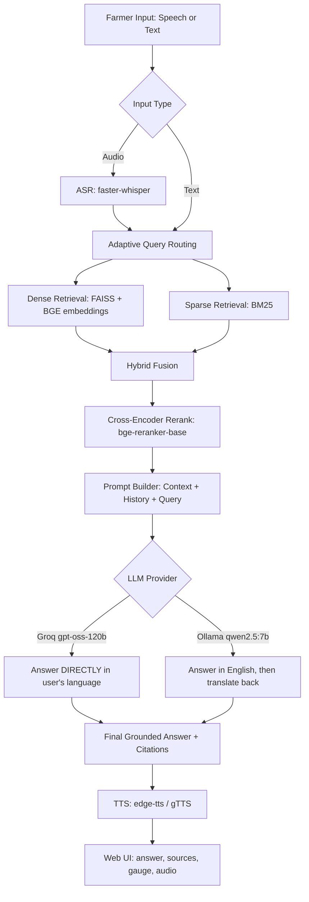

# Plant Doctor Chatbot 🍃

A voice-enabled **Retrieval-Augmented Generation (RAG)** assistant for farmers — crop
diagnoses, pest identification, fertilizer schedules, agricultural guidelines, and Indian
government schemes. It answers in **English, Hindi, Telugu, and Tamil**, from text or voice,
with answers grounded strictly in a curated document base and shown alongside their sources.

The pipeline runs a hybrid dense + sparse search over a FAISS index, reranks the candidates
with a cross-encoder (where resources allow), and generates a grounded answer with an LLM —
**Groq (`openai/gpt-oss-120b`) in the cloud** or **Ollama (`qwen2.5:7b`) locally** — selected
by a single environment variable. Answers come with citations, a confidence gauge, latency
diagnostics, and spoken (TTS) output.

---

## 🖥️ User Interface

The primary UI is a **custom single-page app** (vanilla HTML/CSS/JS, no build step) in
[`web/`](web/), served directly by the FastAPI backend at its root URL (same origin — no CORS,
no separate frontend service). It has:

- **Chat Assistant** — multilingual chat (text + voice), per-reply language switch + translate,
  inline audio, a 270° confidence gauge, performance diagnostics, and recent conversations.
- **Govt Schemes** — filterable scheme cards plus an "Ask AI" box (text + voice) over a separate
  schemes knowledge base.
- **Ingestion Panel** — upload a document or rebuild the whole index.
- **Document Library** — tabbed view of the indexed Agricultural and Government-Schemes bases.
- **Conversation History** and **Settings**.

> A legacy **Streamlit** app ([`app.py`](app.py) + [`components/`](components/)) is kept in the
> repo for reference, but the `web/` SPA served by the backend is the current frontend.

---

## 🏗️ System Architecture



**Embeddings** are `BAAI/bge-small-en-v1.5` (384-dim) either way: `sentence-transformers`
locally, or `fastembed` (ONNX Runtime) in cloud mode — the vectors are identical, so the same
FAISS index works for both.

---

## 🛠️ Tech Stack & Key Components

### ⚙️ Backend (FastAPI + Uvicorn)
Serves the API **and** the `web/` UI from one origin. Endpoints: `/chat`, `/voice`, `/translate`,
`/upload`, `/embed`, `/history` (GET/DELETE), `/health`, and `/` (the SPA).

### 🔍 Retrieval & RAG Pipeline
- **Hybrid search**: **FAISS** dense similarity (`BAAI/bge-small-en-v1.5`) fused with a custom
  pure-Python **BM25** sparse scorer.
- **Cross-encoder reranking** with **`BAAI/bge-reranker-base`** over the top candidates (loaded as
  a singleton; auto-disabled on low-RAM cloud tiers via `RERANKER_ENABLED`).
- **Metadata DB**: SQLite (`data/metadata/metadata.db`, and `data/govt_schemes/metadata/`) tracking
  chunk IDs, sources, pages, and languages.
- **Two knowledge bases**: agricultural documents and government schemes, each with its own FAISS
  index and metadata store.

### 🧠 LLM Abstraction ([`backend/llm/`](backend/llm/))
- **Factory pattern** switching on `LLM_PROVIDER`.
- **Ollama** (local): `qwen2.5:7b`, zero-cost offline inference.
- **Groq** (cloud): `openai/gpt-oss-120b` (fast, capable). Retired model IDs (e.g.
  `llama-3.3-70b-versatile`, decommissioned 2026-08-16) are **auto-remapped** to a current model so
  a stale env var doesn't break production.

### 🧮 Embeddings
- **Local**: `sentence-transformers` (PyTorch) on CPU/GPU.
- **Cloud**: `fastembed` (ONNX Runtime) — same BGE model, far less RAM than PyTorch, no inference
  API or token required.

### 🌐 Multilingual Processing
- **Adaptive routing** detects the query's language by script, retrieves in the right language,
  and keeps the *answer* language independent of the *query* language.
- **Direct generation on capable models**: with Groq, the LLM writes the answer directly in the
  user's language (one fast call). With weaker local models that degrade on Indian languages, it
  generates English then translates back.
- **Translation fallback chain**: `deep-translator` **Google → LLM → MyMemory**, so a rate-limited
  free API never leaves answers untranslated.

### 🎙️ Speech
- **STT**: `faster-whisper` (`base`, int8) — disabled on low-RAM cloud tiers via `ASR_ENABLED`.
- **TTS**: `edge-tts` (Microsoft neural voices) with `gTTS` fallback; audio served from `/static`.

### ⚡ Caching
Persistent SQLite caches for **embeddings**, **translations**, and **LLM responses**
(hashed on prompt + history) under `cache/`.

---

## ⚙️ Environment Configuration

The LLM/embedding mode is chosen by environment variables (see [`.env.example`](.env.example)).

### Local (Ollama, offline)
```ini
LLM_PROVIDER=ollama
OLLAMA_BASE_URL=http://127.0.0.1:11434
OLLAMA_MODEL=qwen2.5:7b
DEVICE=cpu
```

### Cloud (Groq)
```ini
LLM_PROVIDER=groq
GROQ_API_KEY=gsk_your_groq_api_key_here
GROQ_MODEL=openai/gpt-oss-120b
DEVICE=cpu
RERANKER_ENABLED=false   # recommended on low-RAM tiers
ASR_ENABLED=false        # Whisper is too heavy for the free tier
```

> In cloud mode embeddings run locally via `fastembed` — **no `HF_TOKEN` is required**.

---

## 🚀 Local Installation & Setup

**Prerequisites:** Python 3.10–3.12. For local LLM mode, [Ollama](https://ollama.com):

```bash
ollama serve
ollama pull qwen2.5:7b
```

**Setup & run** (a `Makefile` is included):

```bash
make setup            # venv + dependencies + sample documents
cp .env.example .env  # then set LLM_PROVIDER and keys
make run-backend      # FastAPI + the web UI at http://127.0.0.1:8000
```

Open **http://127.0.0.1:8000/** — the backend serves the web UI and the API together.

<details>
<summary>Running the UI on a separate static dev server (optional)</summary>

You can also serve `web/` on its own and point it at the backend:

```bash
python -m http.server 8502 --directory web --bind 127.0.0.1
# open http://127.0.0.1:8502  (it auto-targets the backend on :8000)
```
</details>

<details>
<summary>Legacy Streamlit frontend (optional)</summary>

```bash
make run-frontend     # streamlit run app.py  -> http://localhost:8501
```
</details>

---

## ☁️ Cloud Deployment (Render)

Deploy with the included Blueprint ([`render.yaml`](render.yaml)) — a **single** web service: the
FastAPI backend serves both the API and the `web/` UI at its own URL.

1. Push the repo to GitHub.
2. Render Dashboard → **Blueprints → New Blueprint Instance** → connect the repo.
3. Set env vars during setup:
   - `LLM_PROVIDER = groq`
   - `GROQ_API_KEY = <your key>`
   - `GROQ_MODEL = openai/gpt-oss-120b`
   - `DEVICE = cpu`, `RERANKER_ENABLED = false`, `ASR_ENABLED = false`
4. **Approve / Deploy.** The app is served at the backend service's URL (e.g.
   `https://<service>.onrender.com/`).

> [!IMPORTANT]
> On the **free tier (512 MB RAM)** the app runs with PyTorch, Whisper, and the reranker disabled,
> using Groq for the LLM and `fastembed` (ONNX) for embeddings. This is tight but workable; if the
> service OOMs or restarts, upgrade to an instance with more RAM. Groq occasionally **retires
> models** — the code auto-remaps known-retired IDs, but you can also update the `GROQ_MODEL` env
> var directly (it overrides `render.yaml`).

---

## 🛰️ API Endpoint Reference

| Endpoint | Method | Description |
| :--- | :--- | :--- |
| `/` | `GET` | Serves the web UI (single-page app). |
| `/chat` | `POST` | JSON `{query, session_id, language, kb_type}` → grounded answer, citations, confidence, metrics, TTS audio URL. |
| `/voice` | `POST` | Multipart audio upload (WAV/WebM). Transcribes (STT), runs RAG, returns answer + TTS audio. |
| `/translate` | `POST` | Translates text (Google → LLM → MyMemory fallback) and returns TTS audio. |
| `/upload` | `POST` | Multipart document upload (PDF, DOCX, TXT, MD); chunks and indexes immediately. |
| `/embed` | `POST` | Rebuilds the vector DB from `data/documents/` and clears the response cache. |
| `/history` | `GET` / `DELETE` | Get or clear the conversation memory window for a `session_id`. |
| `/health` | `GET` | Index/DB readiness, model flags, and indexed-document summaries. |

---

## 🧪 Verification & Benchmarks

```bash
make test        # unit tests (chunker, retriever, rag)
make eval        # RAG metrics: faithfulness, precision, recall, relevancy
make benchmark   # latency breakdown across retrieval, rerank, STT, LLM
```

---

## 📄 License

Maintained for agricultural RAG research. Licensed under the [MIT License](LICENSE).
